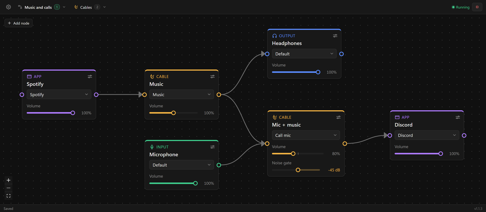

# Audio Graph

A desktop app for Windows and Linux that routes audio by drawing a graph: connect microphones, headphones, apps and virtual cables with arrows, press Start, and the sound goes where the arrows point.



The graph above sends Spotify to the headphones and, at the same time, mixes it with the microphone into a virtual cable that Discord uses as its microphone.

## Features

- **Five kinds of nodes.** Input (microphone), Output (headphones, speakers), App, Cable, and System (the system's default devices).
- **Per-app routing.** An app plays into the device on the right of its node and hears the device on the left. On Windows this is the same setting as *Volume mixer → app output/input device*; on Linux it is the app's streams being moved, like in pavucontrol.
- **Cables.** A cable mixes everything that goes into it and passes it on. On Windows a cable is either a mix point inside the app or a pair of devices of a virtual cable driver. On Linux every cable node is a virtual device that the graph creates while it runs and that other programs can use too.
- **Finding cables (Windows).** *Find cables* in the **Cables** menu adds the device pairs of installed virtual cable drivers, recognized by the drivers' device properties: Virtual Audio Cable lines (also with speaker pins or renamed devices), VB-Cable, its A–D cables and Hi-Fi Cable. Spare sides aren't offered as more cables but can be chosen: VB-Cable's 16-channel input and a VAC line's Mic and S/PDIF recording devices. Voicemeeter and VB-Audio Matrix aren't offered: they are mixers, and sound goes between their devices only the way they route it; a cable can still be made of their devices by hand. A cable whose input and output belong to different driver lines gets a warning. A cable with only its input chosen still works for devices: the app records what is played into the input.
- **Volume on every node.** Devices and cables go from 0 to 200%; apps go up to 100% (their volume in the system mixer).
- **Balance.** A left-right slider under the volume of inputs, cables and outputs, turned on per graph in its options. Like delay, it applies to sound that Audio Graph plays, not to an app or the System node connected straight to an output.
- **Output delay.** A slider on Output nodes shifts their sound in time, for example to match speakers to Bluetooth headphones. Plus plays the output later, minus earlier than the other outputs (sound can't play early, so the other outputs are delayed instead). The range is ±0.5 s by default and up to ±1 s, in 1 ms steps. Only sound that Audio Graph plays can be delayed: an app or the System node connected straight to an output plays through the system, and the node says so.
- **Delay calibration.** *Calibrate delays* in a graph's options plays a short sweep on each of its outputs in turn while a microphone listens, and sets the delays from the measured latencies so the outputs play together: the fastest output keeps no delay, and the late ones get a negative delay as large as their lag, widening the delay range if needed. *Listen* plays a tick on all of them at once with those delays to check by ear; the graph's sound is muted while measuring.
- **Graph options.** The arrow in a graph's row of the graph list opens its options: volume sliders, balance sliders, delay sliders and the delay range, and starting the graph with the app. *Export to a file* there writes the graph with the cables it uses; the button next to *New graph* imports such a file, adding missing cables to the cable list. While a graph's delay sliders are off, its delays aren't applied. The ready-made graphs of a first start have them on; graphs made later start without them.
- **Several graphs at once.** Run them from the graph list; drag graphs and cables by their handles to reorder the lists. A running dot shows which ones are active, and it turns red if something is wrong.
- **Problems are shown in place.** Missing devices, loops, an app connected to two outputs, conflicts between running graphs: the node gets a red note, the arrow turns red, and the header lists everything.
- **Devices that come and go.** When a chosen device is unplugged, its node says so; when it is back, the graph picks it up within a moment. A device that comes back under another id (other USB port, another Bluetooth profile on Linux) is found by its name, as long as only one device has that name.
- **Everything is put back.** When a graph stops or the app quits, apps get their previous devices and volumes, and the system gets its previous default devices. If the app is killed, this happens on the next start.
- **Tray.** Turned on in the settings: closing the window then hides it to the tray, and graphs keep running. Start, stop and quit from the tray menu. Starting the app again shows the hidden window. Without the tray, closing the window quits.
- **Start with the system.** The installed app (not the portable file or the AppImage) can start when you sign in, in the tray or minimized, and start the graphs marked in their options.
- **Settings.** Light, dark or system theme; the tray; English, Russian, Spanish, Chinese or Japanese; hiding the graph map; volume sliders in new graphs; on Windows, turning the cables of a graph off while it isn't running.

## Requirements

**Windows**

- Windows 11 or Windows 10 version 1803 or later (developed on Windows 11).
- [WebView2](https://developer.microsoft.com/microsoft-edge/webview2/), which is already installed on Windows 11 and up-to-date Windows 10.
- For cables between apps, a virtual audio cable driver such as [VB-Audio Virtual Cable](https://vb-audio.com/Cable/) or [Virtual Audio Cable](https://vac.muzychenko.net/). Each driver line is a pair of devices: a playback device that apps play into and a recording device the sound comes out of. Add this pair once in the **Cables** menu (*Find cables* does it for you), then use it in any graph.

**Linux**

- PipeWire with `pipewire-pulse` (Ubuntu 22.10+, Fedora 34+ and most current distributions) or PulseAudio.
- `libpulse0` and WebKitGTK 4.1, which desktop distributions already have.
- No cable driver is needed: cables are created by the graph.
- The tray icon needs a tray in the desktop (on GNOME, the AppIndicator extension). If the tray is on in the settings but the desktop doesn't show it, quit from the settings menu.

## How it works

| Connection | Windows | Linux |
| --- | --- | --- |
| App → device or cable | the app's own output device is set to it | the app's playback streams are moved to it |
| Device or cable → App | the app's own input device is set to it | the app's recording streams are moved to it |
| System → … / … → System | the default output and input devices are switched while the graph runs | the same, through the audio server |
| Between inputs, outputs and cables | the Audio Graph engine: WASAPI shared-mode streams, 48 kHz float stereo, with clock drift correction between devices; an output's delay is held in the link's buffer | the audio server: a loopback per arrow, with the path's volume; an output's delay is added to the loopback's latency |
| Cable | a mix point inside the engine, or a pair of driver devices | a virtual output device and a virtual input device named after the node |

Things that follow from this:

- An app has one output and one input device, so it can't be connected to two places directly. Connect it to a cable and fan out from the cable.
- An app gets its device once it has opened audio. Until then, the node says it is waiting, and the device is assigned as soon as the app starts playing.
- Loops (sound that would come back to where it started) are detected, including loops through several running graphs, and their arrows are not played.

## Running and building

Everything is done by the scripts in `scripts/`, one folder per system:

| | Windows | Linux |
| --- | --- | --- |
| Install the build tools | `scripts\windows\setup.bat` | `scripts/linux/setup.sh` |
| Start in development mode | `scripts\windows\dev.bat` | `scripts/linux/dev.sh` |
| Build | `scripts\windows\build.bat` | `scripts/linux/build.sh` |
| Build the Linux version from Windows | `scripts\windows\build-linux.bat` | |

- **setup** installs what is missing: [Node.js](https://nodejs.org/) 22+, [Rust](https://rustup.rs/), on Windows the C++ Build Tools and WebView2 (through winget), on Linux the system libraries (Debian/Ubuntu, Fedora or Arch; elsewhere see the [Tauri prerequisites](https://v2.tauri.app/start/prerequisites/) plus libpulse). Then the npm packages.
- **dev** starts the app with the code from this folder; interface and Rust changes are picked up while it runs.
- **build** puts the result into `release/<version>/`: on Windows `Audio Graph <version> portable.exe` (a single file, no installation) and `Audio Graph <version> setup.msi`, on Linux `Audio Graph <version>.AppImage`, `audio-graph_<version>_amd64.deb` and `audio-graph-<version>.x86_64.rpm`.
- **build-linux** builds the Linux packages from Windows in WSL, in a WSL distribution of its own with Ubuntu 22.04 (`audio-graph-build`, created on the first run; `wsl --unregister audio-graph-build` removes it). Linux packages run only on distributions as old as the one they were built on or newer, so release packages are built on Ubuntu 22.04: they run on Ubuntu 22.04+, Debian 12+, Fedora and the like.

### Versions

The version is kept in one place, `package.json`: `tauri.conf.json` reads it from there, and the version in `Cargo.toml` is unused. Change it with npm:

```sh
npm version patch    # 1.0.0 → 1.0.1: fixes and small changes
npm version minor    # 1.0.0 → 1.1.0: a new feature
npm version major    # 1.0.0 → 2.0.0
npm version 1.2.3    # an exact version
```

Here `npm version` only changes the number (see `.npmrc`): committing and tagging are done separately. A build stops if its version is already in `release/`: a changed app gets a new number.

### Tests

```sh
npm test                       # the interface: graph files, undo, node problems, devices and cables, translations

cd src-tauri
cargo test                     # the graph planner, storage, settings, mixing buffers, calibration, translations
cargo test -- --ignored --test-threads=1   # Windows: tests on real devices, need Virtual Audio Cable lines 1 and 2 turned on
cargo test engine::linux -- --ignored --test-threads=1   # Linux: tests on the audio server, need pactl, pacat and parec
cargo test driver_properties -- --nocapture   # Windows: what drivers tell about the devices, to teach cable finding a new driver
```

The Windows device tests play only into the cables, turn cable devices off and on for a moment, and put the system's default devices back afterwards.

The app keeps its data in `%APPDATA%\dev.audiograph.app` on Windows and `~/.local/share/dev.audiograph.app` on Linux: graphs, cables, settings, the journal of changed app devices and default devices, and a log (`logs/audio-graph.log`).

## Project layout

| Path | What's there |
| --- | --- |
| `scripts/` | Setup, development and build scripts for Windows and Linux |
| `src/` | The interface: React, [React Flow](https://reactflow.dev/) for the canvas, Zustand for state |
| `src/locales/` | Translations, shared by the interface and the Rust side |
| `src-tauri/src/engine/plan.rs` | Turns graphs into a plan: app routing, engine streams, virtual cables, problems |
| `src-tauri/src/engine/win/` | Executes the plan on Windows: audio streams (`streams.rs`) and Windows device settings (`router.rs`) |
| `src-tauri/src/engine/linux.rs` | Executes the plan on Linux through the audio server (`src-tauri/src/pulse.rs`) |
| `src-tauri/src/calibrate/` | Delay calibration: plays the sweep, records the microphone and finds the sweep in the recording |
| `src-tauri/src/devices/pairs.rs` | Finds the two devices of each virtual cable by what the drivers tell about them (Windows) |
| `src-tauri/src/` | Storage of graphs, cables and settings, device and app lists and their changes, autostart, the tray |

## Translations

Strings work like Android string resources: the code refers to them by codes, and every language has a file `src/locales/<language>.json` that maps the codes to its strings. The interface uses `t("start")`, Rust messages (graph problems, device errors, the tray) use `tr!("issue_loop")`. English (`en.json`) is the base language: a string missing in another language is shown in English. Placeholders are named: `"Stop “{name}”"`.

`cargo test` checks that every language file has every code of `en.json` with the same placeholders, and that every code used in `t("…")` and `tr!("…")` exists.

To add a string: add its code to `en.json` and to every other language file. To add a language: create `src/locales/<language>.json`, add it to `LANGUAGES` and `DICTIONARIES` in `src/i18n.ts`, to `Lang` in `src/settings.ts`, and to `Language` in `src-tauri/src/settings.rs` and the dictionary list in `src-tauri/src/i18n.rs`.
